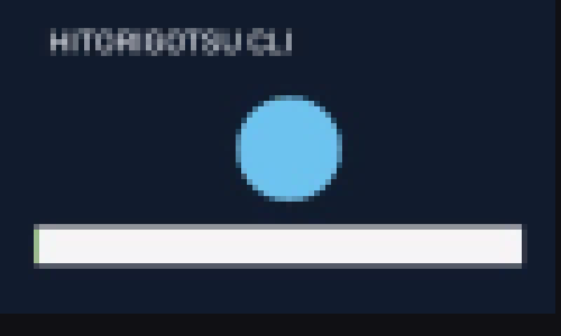
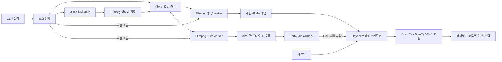

# Hitorigotsu CLI

[English](README.md) · Python 3.12+ · MIT

하치와레의 **ひとりごつ**에서 영감을 받은 독립 터미널 영상 플레이어입니다.
24비트 컬러 블록/ASCII 애니메이션과 동기화된 소리를 재생합니다.
치이카와 공식 제품이 아니며 원본 영상·음원을 포함하지 않습니다.



직접 생성한 도형 영상을 실제 CLI로 실행하고 PTY 출력을 pyte로 해석해 만든 GIF입니다.
저작권이 있는 뮤직비디오의 캡처가 아닙니다. [ASCII 스크린샷](assets/demo-ascii.png).

## 설치

Python 3.12+, [uv](https://docs.astral.sh/uv/getting-started/installation/), PATH에 등록된
FFmpeg와 ffprobe, UTF-8/TrueColor 터미널이 필요합니다. 오디오는 PortAudio를 사용합니다.
YouTube에는 Deno 또는 지원되는 Node.js도 필요합니다. yt-dlp 권장 Python 의존성과 EJS
스크립트는 패키지에 포함됩니다. [최신 런타임 요구사항](https://github.com/yt-dlp/yt-dlp/wiki/EJS).

```sh
# macOS
brew install ffmpeg deno

# Debian / Ubuntu: YouTube용 Deno 또는 최신 Node.js는 별도 설치
sudo apt-get install ffmpeg libportaudio2

# Windows PowerShell: 설치 후 터미널 재시작
winget install Gyan.FFmpeg
winget install DenoLand.Deno
```

저장소를 내려받은 폴더에서:

```sh
uv tool install .
hitorigotsu --help

# 개발 환경
uv sync --locked
uv run hitorigotsu --file ./hitorigotsu.mp4
```

**아직 PyPI에는 게시하지 않았습니다.** 게시 후에는 `uv tool install hitorigotsu-cli`로
설치할 수 있습니다. 현재도 `uv build`로 wheel과 소스 배포 파일을 생성할 수 있습니다.

## 사용법

```sh
hitorigotsu --file ./hitorigotsu.mp4
hitorigotsu "https://www.youtube.com/watch?v=VIDEO_ID"
hitorigotsu --url "https://www.youtube.com/watch?v=VIDEO_ID" --fps 30
hitorigotsu --set-default "https://www.youtube.com/watch?v=VIDEO_ID"
hitorigotsu                    # 설정한 영상 다운로드 후 자동 재생
hitorigotsu --offline          # 검증된 캐시에서 재생
hitorigotsu --mode ascii --width 100
hitorigotsu --mode block --mute --loop --monochrome
hitorigotsu --cache-list
hitorigotsu --clear-cache
hitorigotsu --force-download
```

`VIDEO_ID`는 다운로드 권한이 있는 실제 영상 ID로 바꿔 주세요.
[치이카와 공식 사이트](https://www.anime-chiikawa.jp/)에서 곡 정보는 확인했지만,
공식 전체 MV의 지속적으로 사용 가능한 YouTube URL은 검증하지 못했습니다.
팬 업로드를 공식 영상으로 간주하지 않으며, 검증되지 않은 기본 URL은 넣지 않았습니다.
`--set-default`로 직접 소스를 설정하면 다음 실행부터 다운로드와 재생이 이어집니다.
설정이 없으면 현재 폴더의 `hitorigotsu.mp4`를 찾고, 파일도 없으면 설정 안내를 표시합니다.
명시적으로 입력한 소스가 저장된 기본값보다 우선합니다.

yt-dlp Python API가 **최대 480p** 영상과 음원을 다운로드합니다. FFmpeg 병합·검증이
끝나면 즉시 재생하며, 문자 변환은 재생 중 실시간으로 수행합니다. 1080p/4K로 대체하지
않습니다. yt-dlp의 표준 Deno/Node 런타임은 사용하지만 쿠키, PO 토큰, DRM·지역·인증
제한 우회 기능은 구현하지 않습니다.

## CLI 옵션

| 옵션 | 설명 |
|---|---|
| `SOURCE`, `--file PATH`, `--url URL` | 하나만 지정; 로컬 또는 YouTube watch/shorts/live/embed/youtu.be |
| `--fps N` | 1–240 FPS, 기본 24 |
| `--mode block\|ascii` | 기본 block; 한 셀에 세로 두 픽셀 표현 |
| `--width N` | 최대 가로 문자 수, 실제 터미널 너비 이내로 제한 |
| `--cell-aspect R` | 문자 가로/세로 비율, 기본 0.5; 폰트에 맞춰 조절 |
| `--mute` | 오디오 장치를 열지 않고 시작; M으로 활성화 |
| `--loop` | 반복 재생 |
| `--monochrome` | 회색조 블록 또는 색 없는 ASCII |
| `--set-default SOURCE` | YouTube URL 또는 로컬 절대 경로 저장 |
| `--offline` | URL은 유효한 캐시만 사용, 네트워크 접근 없음 |
| `--force-download` | 성공적으로 다운로드한 파일로 캐시 교체; offline과 동시 사용 불가 |
| `--cache-list`, `--clear-cache` | 캐시 목록 / 완료된 영상 캐시 삭제 |
| `--benchmark` | 재생 후 벤치마크 JSON 출력 |
| `--benchmark-output PATH` | 측정 JSON 파일 저장 |
| `--headless` | 화면 출력 없이 디코딩·변환; 소리를 끄려면 mute 추가 |
| `--duration SECONDS` | 초기 준비를 제외한 재생 경과 시간 제한, 일시정지 시간 포함 |
| `--help`, `--version` | 도움말 / 버전 |

## 키보드 조작

| 키 | 동작 |
|---|---|
| Space | 일시정지 / 재생 |
| Q, Ctrl+C | 종료 및 터미널 복구 |
| M | 음소거 전환 |
| R | 처음으로 이동, 일시정지 상태 유지 |
| ← / → | −5 / +5초 이동 |
| ↓ / ↑ | −30 / +30초 이동 |

## 아키텍처



`source/config/cache/downloader`는 소스와 저장을, `decoder/audio`는 프로세스와 worker를
담당합니다. `renderer`는 순수한 프레임→문자열 함수이고 `terminal`이 터미널 I/O를 소유합니다.
`player`가 제어와 스케줄링을 조정하며 `synchronizer`는 무음 재생 시계를 제공합니다.

### 렌더링 원리

FFmpeg가 BGR 프레임을 디코딩하며 긴 변을 최대 640픽셀로 제한합니다. `fps` 필터가 가변
프레임률을 정규화합니다. 회전과 픽셀 종횡비를 반영하고 OpenCV의 면적 보간으로 축소합니다.
NumPy가 밝기와 ASCII 문자 인덱스를 계산합니다. `▀`의 전경색은 위 픽셀, 배경색은 아래
픽셀의 RGB입니다. ASCII 모드는 밝기 문자와 RGB 전경색을 사용합니다.
인접 셀의 색이 같으면 escape sequence를 생략하고 프레임 문자열을 한 번에 출력합니다.
전체 영상을 메모리에 적재하지 않습니다.

`가로 문자 수 / 세로 문자 수 = 영상 종횡비 / 문자 종횡비`로 비율을 맞춥니다.
매 프레임 터미널 크기를 감지하고 마지막 행·열을 비워 자동 줄바꿈을 피합니다.
Alternate Screen, 커서 숨김과 Home 이동으로 깜빡임을 줄이며 크기 변경 후 남은 영역을 지웁니다.
정상 종료, 예외, Ctrl+C에서 색·커서·버퍼·터미널 모드를 복구합니다.
SIGKILL이나 전원 종료는 정리 코드를 실행할 수 없으므로 필요하면 `reset`을 사용합니다.

### 오디오·영상 동기화

FFmpeg가 48 kHz 스테레오 PCM을 16블록 큐에 전달합니다. sounddevice/PortAudio callback은
1024샘플씩 소비하며 DAC 출력 예정 시각을 제공합니다. 제출된 샘플 시각에서 장치에 대기 중인
지연을 빼 재생 위치를 구하므로 FFplay 시작 지연을 추정할 필요가 없습니다.
언더런 시에는 무음을 출력하고 제출한 샘플 이후로 미디어 시간을 진행시키지 않습니다.
callback은 FFmpeg를 기다리지 않습니다. Python callback이므로 하드 실시간 보장은 아닙니다.

영상 PTS가 이 시계보다 앞서면 짧게 대기하고 한 프레임 이상 뒤처지면 건너뜁니다.
오디오 없이 시작하면 `time.monotonic()`을 사용합니다. 일시정지·탐색 시 기존 스트림을 닫고
정지/이동 시각에서 새로 열어 오래된 큐와 오디오 버퍼를 비웁니다. 구현과 플랫폼 호환성을
단순하게 유지하는 대신 짧은 재버퍼링 지연이 있습니다. 짧은 오디오 꼬리는 영상 끝까지 무음으로 채웁니다.

드리프트는 stdout flush 이후 프레임 PTS와 장치 시계의 차이입니다. 실제 스피커의 음향,
Bluetooth 지연, 터미널 화면 합성 지연을 측정하는 값은 아닙니다. 복잡한 불연속 타임스탬프나
여러 edit list가 있는 영상은 충분히 검증하지 않았습니다.

## 캐시와 오류 처리

platformdirs가 OS별 설정·캐시 폴더를 선택합니다. macOS는 보통
`~/Library/Caches/hitorigotsu-cli`, Linux는 `~/.cache/hitorigotsu-cli`, Windows는
LocalAppData 아래에 저장합니다. 설정은 OS 사용자 설정 폴더에 저장합니다.

YouTube ID마다 `media.mkv`와 크기·SHA-256을 기록한 `complete.json`을 저장합니다.
임시 폴더에서 다운로드·병합·검증을 끝낸 파일만 등록합니다. 캐시 사용 시 전체 파일 해시를
확인하므로 파일 크기에 비례하는 디스크 읽기가 필요하지만 네트워크는 사용하지 않습니다.
중단·변경·손상 파일은 캐시로 인정하지 않습니다. offline은 오류를 표시하고 online은 재다운로드합니다.
Ctrl+C는 활성 임시 폴더를 정리합니다. 강제 종료로 남은 staging 폴더는 무시하며 다운로드 중이
아닐 때 수동 삭제할 수 있습니다. 다른 프로세스가 사용하는 캐시를 동시에 삭제·강제 교체하지 마세요.

FFmpeg 누락, 잘못된 URL/설정, 파일 누락, 비공개·삭제 영상, 네트워크 실패, 디코더·오디오
오류를 안내합니다. YouTube 변경 시 개발자는 `uv sync --upgrade-package yt-dlp`, 설치 사용자는
도구 업그레이드로 yt-dlp를 갱신하세요. HTTP 403은 우회하지 않고 보고합니다.
`--mute`는 오디오 장치를 열지 않아 오디오 장치 없는 환경에서도 작동합니다.

## 테스트와 벤치마크

```sh
uv run pytest -q
uv run ruff check .
uv run ruff format --check .
uv build
uv run python examples/generate_test_video.py /tmp/hitorigotsu-demo.mp4 --seconds 8
uv run hitorigotsu --file /tmp/hitorigotsu-demo.mp4 --benchmark
uv run hitorigotsu --file /tmp/hitorigotsu-demo.mp4 --headless --mute --benchmark
# POSIX 터미널 캡처. 실제 오디오도 켜려면 --audio 추가
uv run python examples/capture_demo.py /tmp/hitorigotsu-demo.mp4 assets/demo
# 다운로드 권한이 있는 URL과 실제 오디오 장치 필요
HITORIGOTSU_E2E_URL="YOUR_AUTHORIZED_URL" uv run pytest -m network -s
```

[측정 수치와 조건](benchmarks/README.md), [검증 기록](docs/validation.md)을 참고하세요.
Actual FPS, 변환/출력 지연, 드롭 프레임, 시계 드리프트, Python CPU·샘플링 RSS를 기록합니다.
초기 준비 시간은 별도이며 FFmpeg 자식 프로세스 CPU·메모리는 포함하지 않습니다.
headless의 출력 지연은 실제 터미널 성능 수치가 아닙니다.

| 플랫폼 | 검증 상태 |
|---|---|
| macOS arm64 | 로컬 pytest, PTY 렌더링·복구, 실제 Core Audio 출력, wheel 설치 검증 |
| Linux | POSIX 구현과 CI 제공, 이 개발 환경에서는 실행하지 못함 |
| Windows | VT 출력·msvcrt 키 입력과 CI 제공, 실제 콘솔·오디오 검증 필요 |

CI는 Python 3.12/3.13 × 세 OS에서 합성 미디어를 테스트하며 네트워크·실제 오디오 장치는
기본 테스트에서 제외합니다. 실제 YouTube E2E는 추출 후 다운로드가 **HTTP 403**으로 실패했습니다.
따라서 **YouTube 다운로드부터 오디오 재생까지의 성공은 검증되지 않았습니다.**
상세 URL과 결과는 검증 기록에 적었습니다.

## 기여와 배포

간결한 모듈, argparse, pytest, `uv.lock`을 사용합니다. 동작 변경에는 테스트를 추가하고,
영상은 생성 스크립트로 준비해 주세요. 다운로드한 영상은 커밋하지 않습니다.
[배포 절차](docs/releasing.md)에 wheel 및 PyPI trusted publishing 설정을 정리했습니다.
이번 구현에서 GitHub 저장소 공개나 PyPI 게시 자체는 수행하지 않았습니다.
[참고 프로젝트 분석](docs/research.md)에는 검토 커밋·라이선스·설계 근거를 기록했습니다.

## 저작권

소스코드와 직접 만든 도형 데모는 MIT입니다. 치이카와 캐릭터, ひとりごつ 음악·녹음·원본 영상의
권리는 각 권리자에게 있습니다. MIT 라이선스가 해당 콘텐츠의 이용 권리를 부여하지 않습니다.
원본 영상·음원·가사나 다른 프로젝트의 소스코드는 포함하지 않았습니다.
다운로드·재생 권한이 있는 콘텐츠만 저작권과 플랫폼 이용 조건이 허용하는 범위에서 사용하세요.
DRM·접근 제한을 우회하지 않으며 프로그램이 사용자의 이용 권한을 대신 판단하지 않습니다.
