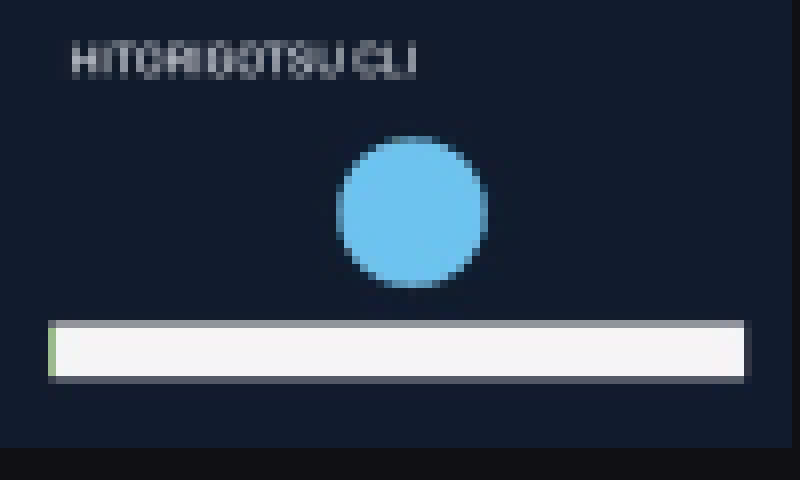
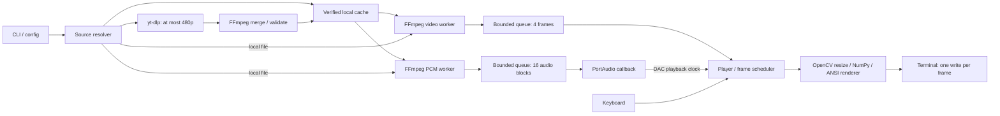

# Hitorigotsu CLI

[한국어](README.ko.md) · Python 3.12+ · MIT

Watch a video in your terminal with 24-bit color, half-block or ASCII rendering,
and synchronized sound. Inspired by Hachiware's **ひとりごつ**, this is an independent
player, not an official Chiikawa product. It contains no Chiikawa video or audio.



This GIF is the actual CLI's PTY output, interpreted with pyte and rasterized to a
GIF. The moving shapes and tone are generated by this repository. This is not a
capture of the copyrighted music video. [ASCII screenshot](assets/demo-ascii.png).

## Install

Requirements: Python 3.12+, [uv](https://docs.astral.sh/uv/getting-started/installation/),
FFmpeg **and ffprobe** on PATH, a UTF-8 TrueColor terminal. Sound uses PortAudio.
YouTube additionally needs Deno or a supported Node.js runtime on PATH; the package
includes yt-dlp's recommended Python dependencies and EJS scripts.
See [yt-dlp's runtime requirements](https://github.com/yt-dlp/yt-dlp/wiki/EJS).

```sh
# macOS
brew install ffmpeg deno

# Debian / Ubuntu (install Deno or current Node.js separately for YouTube)
sudo apt-get install ffmpeg libportaudio2

# Windows PowerShell (restart your terminal after installation)
winget install Gyan.FFmpeg
winget install DenoLand.Deno
```

From a clone of this repository:

```sh
uv tool install .                 # exposes hitorigotsu on PATH
hitorigotsu --help

# Developer installation
uv sync --locked
uv run hitorigotsu --file ./hitorigotsu.mp4
```

The package has **not been published to PyPI yet**. After a maintainer publishes
it, `uv tool install hitorigotsu-cli` becomes the registry installation path.
The wheel and source distribution can already be built with `uv build`.

## Play

```sh
hitorigotsu --file ./hitorigotsu.mp4
hitorigotsu "https://www.youtube.com/watch?v=VIDEO_ID"
hitorigotsu --url "https://www.youtube.com/watch?v=VIDEO_ID" --fps 30
hitorigotsu --set-default "https://www.youtube.com/watch?v=VIDEO_ID"
hitorigotsu                      # download configured source, then play automatically
hitorigotsu --offline            # play configured source from verified cache
hitorigotsu --mode ascii --width 100
hitorigotsu --mode block --mute --loop --monochrome
hitorigotsu --cache-list
hitorigotsu --clear-cache
hitorigotsu --force-download
```

Replace `VIDEO_ID` with an actual authorized video ID. No official MV URL is
preconfigured: the [official Chiikawa site](https://www.anime-chiikawa.jp/) confirms
the song credits, but a durable, official full-MV YouTube URL could not be verified.
Fan uploads are not treated as official. Set your own authorized URL or local file.
Without a saved default, `hitorigotsu` uses `./hitorigotsu.mp4` if present; otherwise
it prints setup instructions and exits. `--set-default` only saves the setting;
the next invocation downloads and plays. An explicit source overrides the default.

YouTube uses the yt-dlp Python API and selects video **at most 480p**, merges/remuxes
with FFmpeg, validates it, then starts real-time rendering. It never falls back to
1080p/4K. The standard yt-dlp Deno/Node challenge runtime is enabled; no cookie,
PO-token, DRM, geographic restriction or authentication bypass is implemented.

## Options

| Option | Meaning |
|---|---|
| `SOURCE`, `--file PATH`, `--url URL` | Choose one source; YouTube watch/shorts/live/embed and youtu.be URLs accepted |
| `--fps N` | 1–240 target FPS; default 24 |
| `--mode block\|ascii` | Default `block`; two vertical pixels per terminal cell |
| `--width N` | Maximum columns, always clamped to terminal width |
| `--cell-aspect R` | Character width / height, default 0.5; adjust for your font |
| `--mute` | Start with no audio device; M enables audio |
| `--loop` | Repeat until quit |
| `--monochrome` | Grayscale blocks or uncolored ASCII |
| `--set-default SOURCE` | Persist YouTube URL or absolute local path |
| `--offline` | Never contact YouTube; require valid cache for URLs |
| `--force-download` | Replace selected video after successful download; incompatible with offline |
| `--cache-list`, `--clear-cache` | Inspect / delete completed video cache |
| `--benchmark` | Print JSON measurements after playback |
| `--benchmark-output PATH` | Save JSON measurements |
| `--headless` | Decode and convert without terminal output; audio still enabled unless muted |
| `--duration SECONDS` | Stop after playback wall time (excludes initial startup; includes pauses) |
| `--help`, `--version` | Help / package version |

| Key | Action |
|---|---|
| Space | Pause / resume |
| Q, Ctrl+C | Exit and restore terminal |
| M | Mute / unmute |
| R | Restart (retains paused state) |
| Left / Right | Seek −5 / +5 seconds |
| Down / Up | Seek −30 / +30 seconds |

## Architecture



`source`, `config`, `cache`, `downloader` own source selection and storage.
`decoder` and `audio` own their FFmpeg processes and worker threads.
`renderer` is a pure frame-to-string function; `terminal` alone owns terminal I/O.
`player` coordinates controls and scheduling; `synchronizer` supplies the silent clock.

### Rendering

FFmpeg decodes to bounded-size BGR frames (longest side at most 640), normalizes
variable frame rates with its `fps` filter, and handles rotation. The probe accounts
for sample aspect ratio. OpenCV downsamples with area interpolation; NumPy computes
luminance and glyph indices. `▀` uses the upper RGB pixel as foreground and lower
RGB pixel as background. ASCII uses a brightness ramp with foreground RGB.
Consecutive cells reuse identical color escapes. Each frame is assembled in memory
and written once, not once per pixel. Only a few frames are retained.

Character geometry uses `columns / rows = video_aspect / cell_aspect`. Each rendered
frame checks terminal size, reserves the last column/row to avoid wrapping, and
clears leftover content. Alternate screen, cursor hiding, and cursor-home updates
reduce flicker. Cleanup restores terminal modes, cursor, colors and screen, including
on exceptions and Ctrl+C. SIGKILL/power loss cannot run cleanup; use `reset` if needed.

### Synchronization

FFmpeg streams 48 kHz stereo PCM into a 16-block queue. `sounddevice`/PortAudio
consumes 1024-sample blocks and reports the DAC timestamp. The media clock subtracts
the queued device latency from submitted sample time. This avoids guessing the
startup latency of a separate FFplay process. On underrun, silence is output and
media time stops advancing beyond submitted samples. The callback never waits for
FFmpeg. It is a Python soft-real-time callback, not a hard-real-time guarantee.

Video compares each normalized frame PTS against this clock. Early frames wait in
short, interruptible intervals; frames at least one frame interval late are dropped.
Mute/no-audio startup uses `time.monotonic()`. Pausing and seeking close and recreate
streams at the frozen/target position, clearing stale video frames and buffered
sound. This trades a short rebuffering delay for straightforward cross-platform
control. The audio tail is padded with silence to the video duration.

Drift measures displayed frame PTS versus the device-reported clock **after stdout
flush**. It does not measure the terminal compositor, speaker acoustics or Bluetooth
latency. Unusual discontinuous timestamps/multiple edit lists are not fully qualified.

## Cache and errors

`platformdirs` chooses config/cache roots (typically `~/Library/Caches/hitorigotsu-cli`
on macOS, `~/.cache/hitorigotsu-cli` on Linux, and LocalAppData on Windows).
Configuration lives in the platform's user config directory.
Each 11-character video ID has a `media.mkv` and `complete.json` containing size and
SHA-256. Downloads use isolated staging directories; only validated completion
creates a cache record. Cache hits verify the whole file, so checking a large cache
has an O(file size) disk-read cost but requires no network. Partial files and changed
hashes are not hits. Offline mode reports corruption; online mode downloads again.
Cancellation cleans the active staging directory. Hard-killed staging directories
are ignored; they may be removed manually when no download is running.
Do not clear/force-download a cache while another process is using that same entry.

Missing FFmpeg, invalid URLs/config, missing files, private/deleted videos, network
failures and decoder/audio-device errors produce actionable errors. Update yt-dlp
when YouTube changes (`uv sync --upgrade-package yt-dlp` for developers; upgrade the
tool for installed users). HTTP 403 or access denial is reported, not worked around.
`--mute` works without opening an audio device.

## Tests, demo and benchmarks

```sh
uv run pytest -q
uv run ruff check .
uv run ruff format --check .
uv build
uv run python examples/generate_test_video.py /tmp/hitorigotsu-demo.mp4 --seconds 8
uv run hitorigotsu --file /tmp/hitorigotsu-demo.mp4 --benchmark
uv run hitorigotsu --file /tmp/hitorigotsu-demo.mp4 --headless --mute --benchmark
# POSIX only: capture real terminal output (add --audio to exercise a device)
uv run python examples/capture_demo.py /tmp/hitorigotsu-demo.mp4 assets/demo
# Opt-in network + audio test; supply a video you are authorized to download
HITORIGOTSU_E2E_URL="YOUR_AUTHORIZED_URL" uv run pytest -m network -s
```

See [measured benchmark results and limitations](benchmarks/README.md) and
[validation record](docs/validation.md). Metrics include actual FPS, mean conversion
and stdout latency, dropped frames, clock drift, Python CPU and sampled RSS.
Startup is separate; CPU/RSS exclude FFmpeg child processes. Headless stdout latency
is a no-op measurement, not a terminal performance claim.

| Platform | Status |
|---|---|
| macOS arm64 | Local pytest, PTY rendering/cleanup, real Core Audio output and wheel installation tested |
| Linux | POSIX implementation and CI matrix provided; not executed in this development environment |
| Windows | VT output and msvcrt keyboard implemented; CI matrix provided, hardware/terminal testing pending |

CI runs Python 3.12/3.13 on macOS/Linux/Windows with synthetic media. It intentionally
skips network and real audio devices. A real YouTube E2E attempt reached extraction
but downloading the media returned **HTTP 403**; successful YouTube download-to-audio
playback is **not verified**. See the validation record for exact URLs and outcomes.

## Contribute and release

Small modules, `argparse`, pytest, and a committed `uv.lock` keep contributions easy.
Add tests for behavior changes; use generated media. Never commit downloaded clips.
[Release instructions](docs/releasing.md) cover wheels and PyPI trusted publishing.
No GitHub repository or PyPI release has been published by this implementation task.
[Reference review](docs/research.md) records source revisions, licenses and design choices.

## Copyright

Code and generated geometric demo assets: MIT. Chiikawa characters, Hitorigotsu
music, recordings and original footage belong to their respective rights holders;
this project's license grants no rights to those works. No original footage/audio,
lyrics or third-party project code is bundled. Only download/play media you are
authorized to use, within applicable copyright and platform terms. The program does
not bypass DRM or access restrictions and cannot determine your permission for you.
